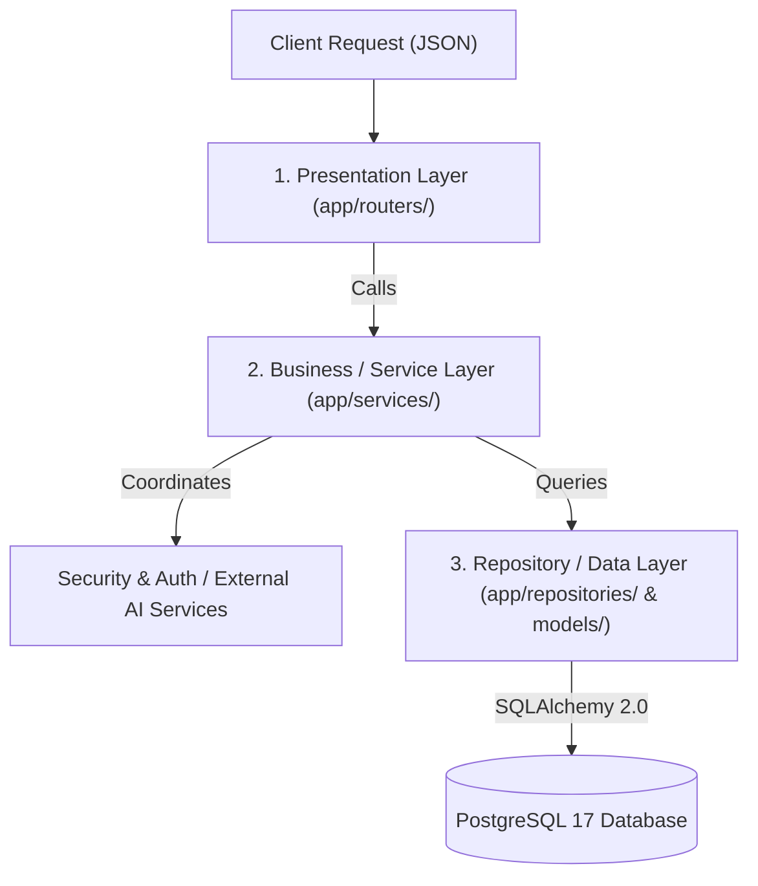
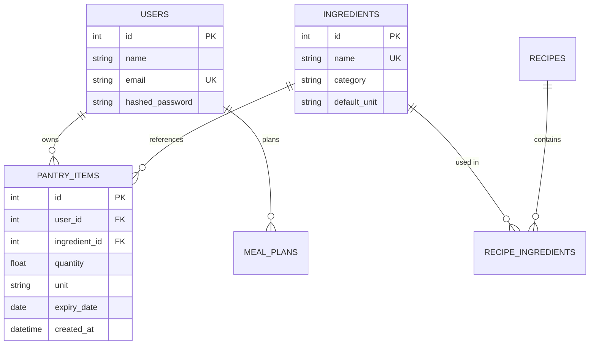

# Backend Architect: Safreyar Architecture Blueprint

This skill guides architectural decisions, structural patterns, and codebase evolution for `safreyar-backend`.

## 1. Architectural Vision: Moving Beyond "Fat Routers"

In early development, route handlers in `app/routers/` often combine request parsing, business logic, ORM queries, and transaction commits in one block. As Safreyar scales to support AI meal suggestions, recipes, nutrition tracking, and pantry expiration notifications, business logic must be decoupled into a clean 3-layer architecture:

---

## 2. Layer Responsibilities

### 1. Presentation Layer (`app/routers/`):
* Receives HTTP request, extracts headers, path, query, and JSON body.
* Leverages Pydantic V2 schemas (`app/schemas/`) for strict data validation.
* Injects dependencies (`current_user`, `db`).
* Delegates work to the Service layer and returns HTTP status codes (`200`, `201`, `204`, etc.).

### 2. Service Layer (`app/services/`):
* Contains core business rules, transactional logic, and multi-entity orchestrations.
* Performs business validation (e.g., verifying that an added pantry item belongs to an existing ingredient and checking date validity).
* Interacts with AI meal generation APIs and external third-party services.
* Raises domain exceptions (e.g. `ItemAlreadyExistsError`, `PermissionDeniedError`) that the presentation layer maps to HTTP exceptions.

### 3. Repository Layer (`app/repositories/`):
* Encapsulates raw database queries and mutations using SQLAlchemy 2.0.
* Isolates SQL dialects and database mechanics away from business rules.
* Makes unit testing simple via mock repositories or in-memory data structures.

---

## 3. Domain Model Boundaries for Safreyar

For practical implementation examples of the Service-Repository pattern, see [references/service-repository-pattern.md](file:///c:/Users/Lenovo/Documents/safreyar-backend/.agent/skills/backend-architect/references/service-repository-pattern.md).
