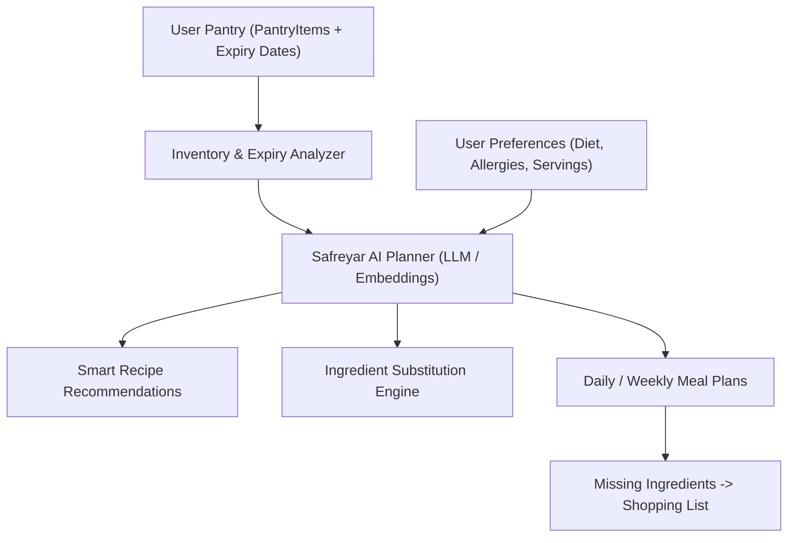

# Safreyar AI Meal Planner & Recipe Intelligence Guide

This skill guides the implementation of Safreyar's future planned features (Section 6 of `API_CONTRACT.md`), connecting pantry inventory with AI-driven meal planning and nutritional calculations.

## 1. Domain Blueprint & Roadmap Capabilities

The Safreyar AI ecosystem transforms raw pantry ingredients into personalized recipes and meal schedules:



---

## 2. Core Feature Implementation Guidelines

### 2.1 AI-Powered Meal Suggestions
* **Input Context:** Current pantry items (prioritizing items expiring within the next 3–7 days) and user dietary restrictions.
* **Prompt Engineering Pattern:** Use structured JSON system instructions with deterministic outputs (e.g. Gemini Function Calling / Pydantic Structured Outputs).
* **Response Contract:** Returns recommended recipes, match percentage (how many required ingredients are currently in the pantry), and missing ingredients.

### 2.2 Ingredient Substitutions
* Match missing ingredients with available pantry alternatives using categorized embeddings or semantic similarity (e.g. "ماست" as a substitute for "خامه ترش").

### 2.3 Expiration Notifications
* Daily background worker checking `pantry_items.expiry_date`.
* Sends push notification or in-app alert when items have $\le 3$ days before expiration, suggesting quick recipes that utilize those specific items.

---

## 3. Database Schema Extensions for Roadmap

```sql
-- Planned recipes table
CREATE TABLE recipes (
    id SERIAL PRIMARY KEY,
    title VARCHAR(200) NOT NULL,
    description TEXT,
    instructions TEXT NOT NULL,
    prep_time_minutes INT,
    cook_time_minutes INT,
    calories INT,
    protein_grams FLOAT,
    carbs_grams FLOAT,
    fat_grams FLOAT,
    created_at TIMESTAMP WITH TIME ZONE DEFAULT NOW()
);

-- Recipe ingredients junction table
CREATE TABLE recipe_ingredients (
    id SERIAL PRIMARY KEY,
    recipe_id INT NOT NULL REFERENCES recipes(id) ON DELETE CASCADE,
    ingredient_id INT NOT NULL REFERENCES ingredients(id) ON DELETE RESTRICT,
    quantity FLOAT NOT NULL,
    unit VARCHAR(50) NOT NULL,
    is_optional BOOLEAN DEFAULT FALSE
);

-- User weekly meal plans
CREATE TABLE meal_plans (
    id SERIAL PRIMARY KEY,
    user_id INT NOT NULL REFERENCES users(id) ON DELETE CASCADE,
    recipe_id INT NOT NULL REFERENCES recipes(id) ON DELETE CASCADE,
    scheduled_date DATE NOT NULL,
    meal_type VARCHAR(20) NOT NULL -- 'breakfast', 'lunch', 'dinner', 'snack'
);
```

For Pydantic V2 schemas and prompt templates, see [references/ai-recipe-schema.md](file:///c:/Users/Lenovo/Documents/safreyar-backend/.agent/skills/safreyar-ai-meal-planner/references/ai-recipe-schema.md).
